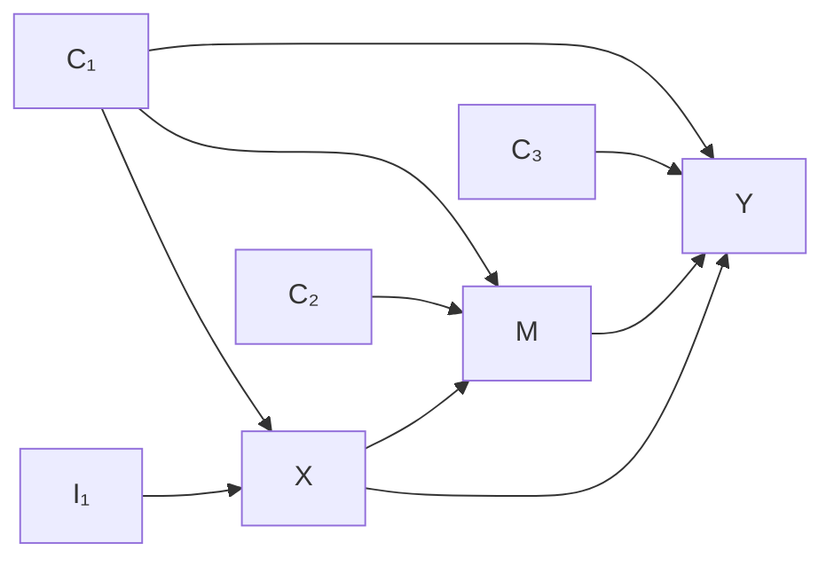

# 连续数据生成器：从具体例子到数学规则

这份说明先展示一张图怎样变成一行数据，再解释代码如何随机生成许多张图。完整代数推导放在 [实现与推导附录](实现与推导附录.md)。

本文对应 `schema.py`、`generator.py`、`run.py`。这里只生成已知机制的数据与效应真值；结论一的方法比较还需要在这些数据上另外运行估计器。

## 1. 先看一个能够手算的完整例子

### 1.1 要研究什么

指定三个目标变量：$X$ 是暴露，$M$ 是本次关注的中介，$Y$ 是结局。我们要比较：把 $X$ 从 0 改为 1 后，$Y$ 平均改变多少，其中多少通过 $M$ 传递。

另外设置四个基线变量：$C_1$ 同时影响 $X,M,Y$；$C_2$ 只影响 $M$；$C_3$ 只影响 $Y$；$I_1$ 只影响 $X$。这里“基线”表示在暴露之前，不表示一定是混杂变量。

这是用于解释步骤的固定小例子，没有开启串行、并行或校准。它不是已输出的 31 列线性样例；实际样例在第 10 节单独说明。

### 1.2 图中的边怎样变成方程

每个节点写一行方程。箭头的来源变量出现在右侧，箭头指向的变量在左侧：

$$
\begin{aligned}
C_1&=\varepsilon_{C_1},&
C_2&=\varepsilon_{C_2},&
C_3&=\varepsilon_{C_3},&
I_1&=\varepsilon_{I_1},\\
X&=0.5C_1+0.7I_1+\varepsilon_X,\\
M&=0.6X+0.5C_1+0.5C_2+\varepsilon_M,\\
Y&=0.2X+0.5M+0.5C_1+0.5C_3+\varepsilon_Y.
\end{aligned}
$$

$\varepsilon_X$ 读作“X 方程的噪声”，代表父节点之外的随机波动；其他下标同理。例子中所有噪声独立，均服从均值为 0、方差为 1 的正态分布。系数在生成整份数据前确定，同一个模型下每个人使用相同系数，每个人的噪声重新抽取。

所以生成数据并非只生成 $X,M,Y$：四个基线变量也有各自的数值与方程。图中没有额外一类叫“V”的变量；后文的 $V_j$ 只是任意一个节点变量的代称。

### 1.3 怎样实际算出一行数据

假设某个人抽到的噪声如下。这是为便于手算选取的示例数值。

| 方程对应节点 | $C_1$ | $C_2$ | $C_3$ | $I_1$ | $X$ | $M$ | $Y$ |
|---|---:|---:|---:|---:|---:|---:|---:|
| 噪声值 | 1 | 2 | −1 | 0 | 0.5 | 0.9 | 0.3 |

先算没有父节点的四个基线变量，然后算 $X$，再算 $M$，最后算 $Y$：

$$
\begin{aligned}
X&=0.5\times1+0.7\times0+0.5=1,\\
M&=0.6\times1+0.5\times1+0.5\times2+0.9=3,\\
Y&=0.2\times1+0.5\times3+0.5\times1+0.5\times(-1)+0.3=2.
\end{aligned}
$$

输出的一行是 $(C_1,C_2,C_3,I_1,X,M,Y)=(1,2,-1,0,1,3,2)$。重复抽取噪声并计算，就得到多个人的表格；列是变量，行是人。

### 1.4 这个例子里哪些是已知的、哪些需要求

| 内容 | 在模拟器里 | 在后续估计实验里 |
|---|---|---|
| 图、系数、噪声分布 | 我们设定，因此已知 | 实验一允许用真图确定调整集 |
| 每个人的所有噪声 | 模拟器抽取 | 通常不提供给估计器 |
| 每个人的观测列 | 由方程计算 | 提供给估计器 |
| 因果效应真值 | 由同一模型的干预计算 | 用于评价估计结果 |
| 估计值、偏差、方差、覆盖率 | 本目录尚不负责估计 | 需要重复估计后计算 |

在这个固定例子中，中介段的 O 集是 $O_M=\{C_1,C_2\}$，结局段的 O 集是 $O_Y=\{C_1,C_3\}$。意思是分别使用 $E[M\mid X,C_1,C_2]$ 与 $E[Y\mid X,M,C_1,C_3]$；其中 $E[\cdot\mid\cdot]$ 表示条件期望。第 8 节解释一般图的计算规则。

## 2. 全文统一的名字：数据列、集合、参数分开写

### 2.1 数据列的角色和代码名称

下面数学名是为了方便阅读；CSV 列名和代码字段保持原样。单个节点名不会表示两个变量相乘。

| 本文数学名 | 代码/数据列名 | 允许的路径 | 对应配置 |
|---|---|---|---|
| $C_1,C_2,\ldots$ | `C001,...` | 普通基线，可指向其他基线、目标或辅助节点 | `n_baseline` 中扣除专门角色后的数量 |
| $I_1,I_2,\ldots$ | `I001,...` | 只直接指向 $X$ | `n_inst` |
| $Q_1,Q_2,\ldots$ | `PM001,...` | 只指向 $M$ | `n_pm` |
| $R_1,R_2,\ldots$ | `PY001,...` | 只指向 $Y$ | `n_py` |
| $N_1,N_2,\ldots$ | `U001,...` | 无边，独立无关列 | `n_irrelevant` |
| $B_1,B_2,\ldots$ | `XM001,...` | $X\to B_1\to\cdots\to M$，M 前的串行节点 | `xm_chain_nodes` |
| $A_1,A_2,\ldots$ | `MY001,...` | $M\to A_1\to\cdots\to Y$，M 后的串行节点 | `my_chain_nodes` |
| $P_1,P_2,\ldots$ | `M2_001,...` | 各自形成 $X\to P_k\to Y$，与 M 并行 | `n_parallel` |
| $D_1,D_2,\ldots$ | `D001,...` | $X\to D_k$，不通往 $M,Y$ | `n_post_descendants` |
| $H_1,H_2,\ldots$ | `L001,...` | $X\to H_k\to M$，同时 $H_k\to Y$ | `n_middle_confounders` |

$k$ 是该类节点的编号。$Q_k,R_k$ 是这里的纯预测节点名称；后文调整**集合**明确写成 $C_M,C_Y$。

当前不额外连接这些辅助路径之间的边。例如不会自动添加 $B_1\to Y$ 或 $P_1\to M$。节点角色描述生成真值，不能把角色标签直接当作算法已经识别出的结果。

### 2.2 集合与公式记号

| 记号 | 唯一用途 |
|---|---|
| $C=\{C_1,\ldots,C_{n_C}\}$ | 普通基线变量集合，$n_C$ 是其数量 |
| $S\subseteq C$ | 从普通基线中指定的、同时直接指向 $X,M,Y$ 的共享组 |
| $E_X,E_M,E_Y$ | 分别指向三个端点的额外普通基线组 |
| $O_M,O_Y$ | 生成完整图后计算的两段 O 集 |
| $C_M,C_Y$ | 任意待比较的中介段、结局段调整集合，不等同于普通基线池 $C$ |
| $V_j$ | 任意节点变量，$j$ 是节点索引；$V_i$ 表示它的某个父节点变量 |
| $\varepsilon_j$ | 节点 $j$ 的噪声，和列名 `U001` 无关 |
| $w_{i\to j}$ | 边 $i\to j$ 的系数，例如 $w_{X\to M}$ |
| $X\times M$ | 两个数值的乘积，和节点名 `XM001` 无关 |
| $A\cup B,A\cap B,A\setminus B$ | 并集、交集、从 A 中剔除也属于 B 的元素 |

## 3. 哪些设计来自原 D3，哪些是新增选择

依据 [实验一_1011.md 第 4 节](../../../doc/实验一_1011.md)，原 D3 包括固定的 $X\to M\to Y$ 主干、$X\to Y$、split/common 基线结构、$C_1\to C_2$、工具及纯预测角色、弱父点、并行中介和暴露后非中介。

| 当前生成器中的设计 | 来源及目的 | 审阅时需要判断什么 |
|---|---|---|
| 主干、并行中介、角色变量 | 原 D3 中已有相应结构 | 是否保留要比较的角色和路径 |
| 随机普通基线网络 | 本次新增；扩展基线间依赖结构 | 是否需要；Poisson 连边方式是否合适 |
| 随机共享组与端点额外组 | 本次新增的可调连接规则 | 随机重叠能否支持所需的受控比较 |
| M 前后串行长链 | 本次新增；检查路径加长后的情况 | 是否纳入主实验或仅作扩展 |
| 成组校准 | 本次新增；控制基线贡献的尺度 | 是否会改变本来想比较的效应强度 |
| 可选非线性、交互与噪声族 | 扩展机制 | 是否满足拟检验命题的条件 |
| 中间混杂边界 | 单独构造不满足调整识别条件的情况 | 作为边界报告，不并入合法效率比较 |

“可配置”不等于“每个选项都必须开启”。当前随机生成器也不是原 D3 的逐项复现：例如原 D3 规定弱父点同时连向 $M,Y$；这里的 `weak_fraction` 是随机边的弱化概率，并不等同于那个角色因子。

基线内部可以没有边，关闭方法为 `baseline_mean_parents=0` 或 `baseline_max_parents=0`。串行路径用对应数量 `0` 关闭，校准用 `enabled=false` 关闭。各允许开关必须与节点数量一致。

## 4. 第一步：只生成图，还不生成人的数值

### 4.1 先确定各类节点数量

`n_baseline` 是全部基线列的数量，包含普通基线和四类专门基线。下式中，$n_{\mathrm{base}}$ 对应 `n_baseline`；$n_I,n_Q,n_R,n_N$ 分别对应 `n_inst`、`n_pm`、`n_py`、`n_irrelevant`。因此普通基线数量为：

$$
n_C=n_{\mathrm{base}}-n_I-n_Q-n_R-n_N.
$$

例如 `review_linear.toml` 中共有 24 个基线，每类专门角色各 2 个，剩下 $24-2-2-2-2=16$ 个普通基线。$X,M,Y$ 和暴露后的辅助节点另计。

### 4.2 普通基线之间怎样连边

这一步只连接 $C$ 中的变量，不给 $X,M,Y$ 选择父节点。

1. 随机排列普通基线，例如 $C_3,C_1,C_4,C_2$。
2. 轮到一个节点时，只允许前面的节点指向它。
3. 抽取“想选几个父节点”的非负整数，再受可选数量和配置上限限制。
4. 在前面的节点中，无放回地随机选出相应数量，添加指向当前节点的边。

为精确对应代码，在本小节用 $j$ 表示**排列位置**，$K_j$ 表示这次抽到的父节点数量，$d_j$ 表示实际数量。$\lambda$ 是配置 `baseline_mean_parents`；$d_{\max}$ 是配置 `baseline_max_parents`。

$$
K_j\sim\operatorname{Poisson}(\lambda),\qquad
 d_j=\min(K_j,j-1,d_{\max}).
$$

$\sim$ 表示“服从该分布”。Poisson 分布用于抽取非负整数，$K_j$ 的期望为 $\lambda$。这些量仅用于生成图，不成为数据列。实际平均父节点数经过截断，不保证等于 $\lambda$。

例如排在第三位的 $C_4$ 前面只有 $C_3,C_1$，即使抽到 $K_3=5$，且上限为 3，也只能选 $d_3=2$ 个父节点，得到 $C_3\to C_4$ 与 $C_1\to C_4$。

采用 Poisson 分布是当前实现选择，不是论文理论要求，也不自动保证医疗数据代表性。

### 4.3 再确定哪些普通基线直接影响 X、M、Y

先从普通基线池 $C$ 中无放回选出共享组 $S$，数量为 `n_shared`。对 $S$ 中的**每个变量**，各添加三条边，分别指向 $X,M,Y$。

再从剩余的 $C\setminus S$ 中分别抽取三组：$E_X$ 指向 X，$E_M$ 指向 M，$E_Y$ 指向 Y；数量分别由 `n_x_extra`、`n_m_extra`、`n_y_extra` 指定。

每组内部不重复，但三组之间允许重复。例如：

$$
C=\{C_1,C_2,C_3,C_4\},\quad
S=\{C_1\},\quad E_X=\{C_2\},\quad
E_M=\{C_2,C_3\},\quad E_Y=\{C_4\}.
$$

这意味着 $C_1$ 指向三个端点，$C_2$ 指向 X 和 M，$C_3$ 指向 M，$C_4$ 指向 Y。

若用 $\operatorname{pa}_C(X)$ 表示“X 的父节点中属于普通基线池 C 的部分”，则：

$$
\operatorname{pa}_C(X)=S\cup E_X,\quad
\operatorname{pa}_C(M)=S\cup E_M,\quad
\operatorname{pa}_C(Y)=S\cup E_Y.
$$

实际三端共享组为 $S\cup(E_X\cap E_M\cap E_Y)$。所以 `n_shared` 只控制指定共享组的数量，不保证实际共享数量恰好相等，更不控制 $O_M\cap O_Y$ 的大小。

### 4.4 最后添加主干、专门角色与辅助路径

主干始终保留 $X\to M$ 和 $M\to Y$；开启直接边且 `direct_weight` 非零时添加 $X\to Y$。串行路径在直接主边之外增加；并行路径绕过 M。

专门工具节点只指向 X，纯中介预测节点只指向 M，纯结局预测节点只指向 Y，无关节点无边。每个暴露后辅助节点另外从普通基线池中抽取 `n_auxiliary_baseline_parents` 个父节点。

所有规则都沿共同的先后关系向前连接。生成后还执行无环检查，再求拓扑排序。这里“拓扑排序”指任何节点都排在其全部父节点之后，因此生成数值时不会用到尚未计算的父节点。

## 5. 第二步：给每个节点确定数值方程

### 5.1 通用方程只是小例子的统一写法

先看 M 的例子：$M=0.6X+0.5C_1+0.5C_2+\varepsilon_M$。右侧是各父节点的贡献之和，再加噪声。

对任意节点使用同一种写法。$V_j$ 是当前节点变量，$b_j$ 是截距，$\operatorname{pa}(j)$ 是其父节点集合；边 $i\to j$ 使用系数 $w_{i\to j}$ 和函数 $h_{i\to j}$：

$$
V_j=b_j+\sum_{i\in\operatorname{pa}(j)}
w_{i\to j}\,h_{i\to j}(V_i)+\varepsilon_j.
$$

$\sum$ 表示将所有父节点贡献相加。没有父节点时，这一项为 0。恒等函数 `id` 不改变输入：$h(z)=z$，因此上式退化为普通线性加和。

结局节点 Y 还可以额外增加 $\gamma X\times M$；$\gamma$ 是配置 `outcome_interaction`。例如 $Y=0.2X+0.5M+0.25X\times M+\cdots$ 时，M 的系数成为 $0.5+0.25X$。交互设为 0 就没有这一项；开启时配置必须同时包含 X→Y 和 M→Y。

### 5.2 系数怎样取值

| 边类别 | 初始系数来源 | 校准是否可能改变它 |
|---|---|---|
| X→M、M→Y、X→Y | `xm_weight`、`my_weight`、`direct_weight` | 否 |
| M 前后的串行链 | `chain_weight` | 否 |
| X→并行中介、并行中介→Y | `parallel_x_weight`、`parallel_y_weight` | 否 |
| 工具→X、纯预测→M 或 Y | `instrument_weight`、`predictor_weight` | 是，属于基线来源贡献 |
| 其余未固定权重的边 | 随机抽取幅度、符号和弱化标记 | 基线来源边会被校准；其他边不会 |

随机边依次抽取：在 `[weight_min, weight_max]` 内均匀取正幅度，以 `negative_edge_fraction` 的概率变为负号，再以 `weak_fraction` 的概率乘以 `weak_multiplier`。

例如幅度 0.5、取负号、且乘弱化倍数 0.2，初始权重就是 $-0.5\times0.2=-0.1$。这些概率是每条随机边的抽样概率，不保证有限图的实际比例恰好等于配置。

`raw_weight` 保存弱化后的初始系数，`weight` 保存校准后真正使用的系数。`weak_draw=true` 仅说明初始抽样发生过弱化，不能保证校准后仍然很弱。

### 5.3 函数、截距和噪声怎样取值

受保护的主干、串行、并行因果边统一使用 `protected_function`。其他边在 `additive_nonlinear` 模式下，以 `nonlinear_fraction` 的概率从 `edge_functions` 中非 `id` 的候选函数均匀选择；没有非恒等候选时仍为 `id`。可用函数为恒等、双曲正切 `tanh`、正弦 `sin`。

每条边先分别变换父节点，再乘权重，最后相加；不是把所有父节点加起来后再统一做非线性变换。线性模式要求函数全部恒等且无交互。

截距按 `intercept_sd` 抽取一次，随后在同一模型的所有人、所有重复和干预世界中固定。其分布是均值 0、标准差 `intercept_sd` 的正态分布。

各行、各节点的噪声独立。令 $\sigma$ 为 `noise_sd`，$\nu$ 为 `noise_df`，则：

| 配置 | 生成噪声的方法 | 含义 |
|---|---|---|
| `normal` | $\varepsilon_j\sim N(0,\sigma^2)$ | 均值 0、标准差为 σ 的正态噪声 |
| `laplace` | $\varepsilon_j\sim\operatorname{Laplace}(0,\sigma/\sqrt2)$ | 第二个参数是尺度，最终方差为 σ² |
| `student_t` | $\varepsilon_j=\sigma\sqrt{(\nu-2)/\nu}\,T_j$，$T_j\sim t_\nu$ | ν>2 时最终方差为 σ² |

Student-t 的有限方差不保证有限四阶矩；后者需要 ν>4。所有噪声都是方程内部的随机量，不是无关数据列 `U001`。

## 6. 第三步：可选的校准，之后冻结模型

这里控制的是“基线父节点合计贡献有多大”。例如 M 方程中基线贡献是 $0.5C_1+0.5C_2$，而 $0.6X$ 不属于这个校准组。

先独立生成一批校准样本。对每个节点计算其基线父节点贡献之和的样本标准差，用目标标准差除以这个数，将该组系数统一乘以所得倍数。例如原标准差为 2、目标是 0.8，则该组所有系数乘以 $0.8/2=0.4$。

精确写法如下。$\mathcal B_j$ 是节点 j 的基线父节点集合，$r$ 是校准样本行号，$R_j^{\rm raw}(r)$ 是该行的基线贡献；$s_j$ 是它在校准样本中的标准差，$s_{\mathrm{target}}$ 是配置 `target_signal_sd` 指定的目标标准差，$c_j$ 是缩放倍数：

$$
R_j^{\rm raw}(r)=\sum_{i\in\mathcal B_j}w_{i\to j}^{\rm raw}h_{i\to j}(V_i(r)),\qquad
s_j=\operatorname{SD}_{\rm cal}(R_j^{\rm raw}),
$$

$$
c_j=\frac{s_{\mathrm{target}}}{s_j},\qquad
w_{i\to j}^{\rm final}=c_jw_{i\to j}^{\rm raw}\quad(i\in\mathcal B_j).
$$

校准沿拓扑顺序执行，每调整完一个节点就重新计算其数值，使下游使用更新后的父节点。无基线父节点时跳过；有父节点但标准差非有限或不大于 `scale_floor` 时拒绝设计。

校准不调整主干、串行及并行因果边，也不调整交互系数。它不固定总信噪比，不保证新样本中基线贡献的标准差恰好等于目标；它还可能放大初始弱边。因此必须审阅最终系数。

校准完成后冻结图、函数、系数和截距，再生成观测样本。不能每个观测重复重新校准，否则比较的就不再是同一个固定分布。

## 7. 第四步：观测数据与干预真值分别生成

### 7.1 观测数据

对每个人独立抽取一整套噪声，按拓扑顺序代入方程，过程与第 1.3 节相同。若生成 n 个人、总共有 p 个节点，就得到 n 行 p 列的表格。`columns`/`order` 记录列顺序。

### 7.2 干预与同一个人的三个计算场景

干预 X=x 是把 X 的整行方程替换为常数 x，其他方程保持不变并重新计算。不能只修改数据表中的 X 列而保留原 M、Y。

配置 `x0`、`x1` 分别是参照和比较暴露值。例如取 0 和 1，只表示比较两个连续暴露水平，不限制观测 X 只能取这两个数，也不默认相差一个标准差。

对同一个人保留同一套噪声，计算：

| 场景 | 怎样修改方程 | 记录的量 |
|---|---|---|
| 参照场景 | 固定 X=x₀，其他节点正常生成 | 中介 $M_0$、结局 $Y_0$ |
| 比较场景 | 固定 X=x₁，其他节点正常生成 | 中介 $M_1$、结局 $Y_1$ |
| 混合场景 | 固定 X=x₁，同时将 M 固定为该人的 $M_0$ | 结局 $Y_{10}$ |

$Y_{10}$ 的下标只是标记“X 用比较水平、中介用参照水平”，不是乘积。所有其他节点，包括串行和并行路径节点，都按其方程重新计算。

对于第 1.3 节的那个人，这三个场景分别给出：

$$
M_0=2.4,\quad Y_0=1.5;\qquad M_1=3,\quad Y_1=2;\qquad Y_{10}=1.7.
$$

因此该人的总变化为 0.5，其中经 M 的变化为 $2-1.7=0.3$，绕过 M 的变化为 $1.7-1.5=0.2$。

### 7.3 总体效应怎样定义

$E[\cdot]$ 表示对生成分布取平均。三种总体效应为：

$$
\mathrm{TE}=E[Y_1-Y_0],\qquad
\mathrm{NIE}=E[Y_1-Y_{10}],\qquad
\mathrm{NDE}=E[Y_{10}-Y_0].
$$

TE 是总效应；NIE 是固定结局暴露为 x₁ 时、通过目标 M 的自然间接效应；NDE 是将目标 M 保持在参照水平时的自然直接效应。逐人和总体都有 TE=NIE+NDE。

“直接”相对于目标 M 定义：$X\to P_1\to Y$ 绕过 M，属于 NDE；$X\to B_1\to M\to Y$ 经过 M，属于 NIE。

### 7.4 线性时精确计算，非线性时数值近似

线性且无交互时，令 $\Delta x=x_1-x_0$；$a$ 表示 X 每增加一个单位引起的 M 总变化，$b$ 表示 M 每增加一个单位引起的 Y 总变化。它们包括所有对应路径，不只是直接边：

$$
\mathrm{NIE}=\Delta x\,a b.
$$

同一路径上的边权相乘，不同路径的贡献相加。绕过 M 的路径贡献之和再乘 Δx 得到 NDE。代码实际按拓扑顺序递推总响应，避免枚举所有路径；完整递推式见附录第 8 节。

非线性或有交互时，独立生成 `truth_samples` 个人的噪声，逐人计算三个场景，再对配对差值求平均。真值近似的 Monte Carlo 标准误（MCSE）为“个人差值的样本标准差 / 真值人数的平方根”。分块计算由 `chunk_size` 控制，每个人的三个场景仍共享同一套噪声。

MCSE 衡量数值求真值的误差，不是后续观测估计器的标准误。线性精确值记为 `truth_exact_linear`，非线性近似记为 `truth_mc_nonlinear`。

## 8. 第五步：由完整图计算两段调整集并检查合法性

### 8.1 普通基线池 C 与 O 集的区别

C 是生成节点时的分类；O 是针对因果查询、从完整图计算的调整集。两段的名字是 $O_M$（用于中介段）和 $O_Y$（用于结局段）。它们可以重叠，也可以不同。

第 1 节的例子中，$O_M=\{C_1,C_2\}$、$O_Y=\{C_1,C_3\}$。纯预测变量也可能进入 O，所以 O 不等于“全部混杂变量”。

“O”来自 optimal adjustment set。名称本身不保证任意模型、任意估计方法下都最优；两段组合的最优性需要论文一规定的条件。

### 8.2 一般图中的计算规则

先定义两个输入：$T$ 是本段处理变量集合，$Z$ 是本段目标集合。中介段取 $T=\{X\},Z=\{M\}$；结局段取 $T=\{X,M\},Z=\{Y\}$。

计算时：找出从 T 到 Z 的 proper 因果路径，即从一个处理节点出发、之后不再经过其他处理节点的有向路径。将这些路径上除起点之外的节点组成集合 $\operatorname{cn}(T,Z)$。取这些节点的父节点并集，再剔除路径因果节点及其后代，以及处理节点。

用 $\operatorname{forb}(T,Z)$ 表示上述路径因果节点及其后代，公式是：

$$
O(T,Z)=\operatorname{pa}(\operatorname{cn}(T,Z))
\setminus\bigl(\operatorname{forb}(T,Z)\cup T\bigr).
$$

$\operatorname{pa}$ 对一个集合取所有成员的父节点并集。两段分别计算 $O_M=O(\{X\},\{M\})$、$O_Y=O(\{X,M\},\{Y\})$。因此长链中间节点的基线父节点也可能进入 O，不能总以“端点的直接父节点”代替。

### 8.3 比较哪些调整方案

令 $P^0$ 表示全部非 X 后代的节点，再去掉 X、M、Y。当前生成器中它是基线候选池。

| 方案 | 中介段使用 | 结局段使用 |
|---|---|---|
| `O` | $O_M$ | $O_Y$ |
| `FULL` | $P^0$ | $P^0$ |
| `SHARED` | $O_M\cup O_Y$ | $O_M\cup O_Y$ |
| `SHAREDm`（有专门纯 M 预测节点时） | 共用并集中去掉 `PM...` 节点 | 同左 |

对于任意待比较对 $(C_M,C_Y)$，代码先检查并集能否同时调整 X→M 和 {X,M}→Y，再检查两段各自省略的变量是否满足相应条件独立。$A\perp B\mid D$ 表示给定 D 后 A 与 B 独立；具体条件为：

$$
M\perp(C_Y\setminus C_M)\mid X,C_M,\qquad
Y\perp(C_M\setminus C_Y)\mid X,M,C_Y.
$$

调整判据还要求不纳入禁调节点，并阻断非因果路径。附录第 11 节与 `paper1/graphs.py` 给出完整规则。无中间混杂设计若有主要比较方案不合法，构建直接报错。

### 8.4 中间混杂属于单独的边界

若有 $X\to H_1\to M$ 且 $H_1\to Y$，H₁ 同时是 X 的后代和 M–Y 的混杂因素。这里仍能用已知结构方程算反事实真值，但没有论文一要求的合法基线调整对。

输出 `boundary_middle_confounding` 标记这种边界；其他通过图检查的设计标为 `admissible_known_graph`。合法性检查不等于效率最优性证明。

## 9. 怎样判断这些数据能否支持结论一

结论一关心“不同合法调整方案的估计方差”，所以仅有图、结构真值和 TE=NIE+NDE 不够。还需明确命题条件、选用相应估计器，并在同一固定模型下重复抽样比较。

论文一的可分条件作用于**条件均值**。令 $o$ 是结局调整集 $O_Y$ 的一个具体取值，并定义：

$$
\mu(x,m,o)=E[Y\mid X=x,M=m,O_Y=o].
$$

NIE 可分指存在函数 f、g，使 $\mu(x_1,m,o)=f(m)+g(o)$；NDE 可分指存在函数 u、v，使 $\mu(x_1,m,o)-\mu(x_0,m,o)=u(m)+v(o)$。这些函数各自只依赖一种输入，不能含 m 与 o 的交互。f、g、u、v 是函数名称，不是数据列或噪声。

线性、高斯、无交互的设计具有线性条件均值，因此这些条件成立。代码仅在这样的无中间混杂设计中记录 `verified_linear_gaussian`；其他设计记为 `not_certified`，不凭“结构方程是加和”自动认证。

当前还可以输出适中线性图的解析均值、协方差以及总体 OLS 结果。这些可核对回归极限和结构真值是否一致；矩阵推导见附录第 9、12 节。它们不是论文一的非参数有效影响函数方差，也不能代替后续效率实验。

`max_covariance_nodes` 限制解析协方差输出，因为 p 个节点的完整协方差要存 p² 个数。超过该限制会跳过这个辅助结果。高维、尤其 p≥n 时，也不能因为最小二乘程序能给出某个解，就直接沿用普通满秩 OLS 的方差比较。

## 10. 对照目前真正输出的线性样例

配置在 [review_linear.toml](examples/review_linear.toml)，最终逐节点方程在 [equations.md](../../paper1_out/data_generation_review_v1/linear/graph_000/equations.md)。本节系数取自当前配置，与第 1 节手算小例子分开。

当前样例既有直接主边，也有各含一个节点的串行路径：

$$
X\xrightarrow{0.6}M,\quad X\xrightarrow{0.6}B_1\xrightarrow{0.6}M,
$$

$$
M\xrightarrow{0.5}Y,\quad M\xrightarrow{0.6}A_1\xrightarrow{0.6}Y.
$$

所以 X→M 的总响应 a 和 M→Y 的总响应 b 为：

$$
a=0.6+0.6\times0.6=0.96,\qquad
b=0.5+0.6\times0.6=0.86.
$$

比较 x₀=0 与 x₁=1，得到 NIE=$0.96\times0.86=0.8256$。绕过 M 的路径包括直接边 X→Y（0.2）以及并行路径 X→P₁→Y（0.5、0.4），所以 NDE=$0.2+0.5\times0.4=0.4$，TE=1.2256。

**这解释的是当前样例的真值，不是对论文一效率结论的检验。** 判断设计是否合适，需要分别审阅随机连接规则、开启的结构、最终参数和后续比较的统计对象。

## 11. 配置、随机种子与输出怎样核对

| 配置节 | 改变什么 | 不同层次 |
|---|---|---|
| `[graph]` | 列数、连边及角色开关 | 决定结构 |
| `[mechanism]` | 系数、函数、噪声、截距和交互 | 决定结构方程 |
| `[calibration]` | 是否缩放基线贡献及目标尺度 | 修改并冻结最终系数 |
| `[experiment]` | 人数、图数、每图重复数、种子、暴露对比、真值样本数 | 决定抽样实验 |
| `[output]` | 目录、CSV、绘图与协方差规模限制 | 决定导出形式 |

`n_graphs` 改变独立模型数；`n_replicates` 是固定同一模型后的观测重复数；`n_samples` 是每份数据的人数。三者不要混为一种重复。

图、机制、校准、观测、真值使用分别派生的随机种子，同一图的观测重复只改变观测噪声。输出记录实际派生种子、源码哈希、配置和环境，以便重建。完整派生协议见附录第 13 节。

| 要判断的问题 | 去看哪里 |
|---|---|
| 到底谁直接影响谁？ | `design.json` 的 `edges`，以及 `graph.png` |
| 实际用了什么方程和系数？ | `equations.md`；精确系数以 `design.json` 为准 |
| 每个人生成的列值是什么？ | `preview_r000.csv`、`data_r000.csv` |
| 同一模型重复时什么固定？ | 图、函数、截距、最终权重固定；观测噪声变化 |
| 真值怎样取得、精确还是近似？ | `truth.kind`、效应值、`mcse_*` 和第 7 节 |
| 两段调整集是谁，是否合法？ | `query.O_M`、`query.O_Y`、`query.admissible` |
| 是否满足已认证的可分条件？ | `query.marginal_separability` |
| 是否已完成效率比较？ | 当前这些导出没有完成新的估计器方差比较 |

代码自检包括无环、种子复现、同噪声干预、线性效应与协方差、非线性参考计算、校准与调整合法性。这些检查保证实现与指定模型一致；是否支持目标结论，仍取决于实验设计与比较结果。
